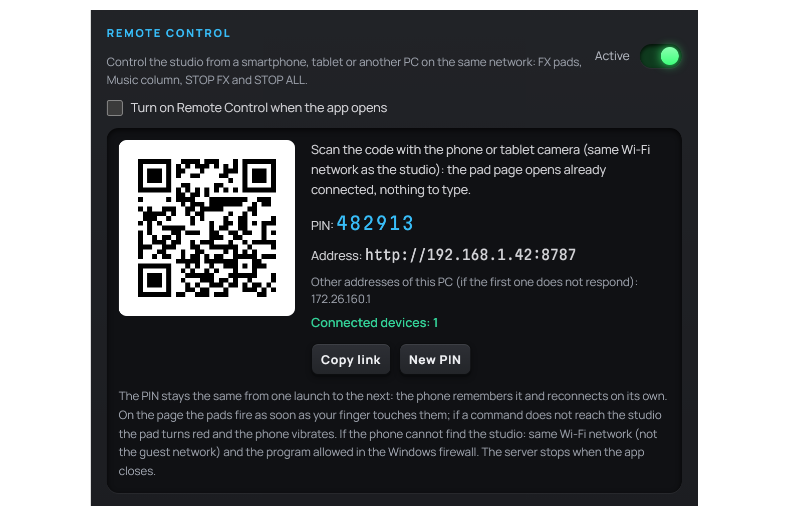
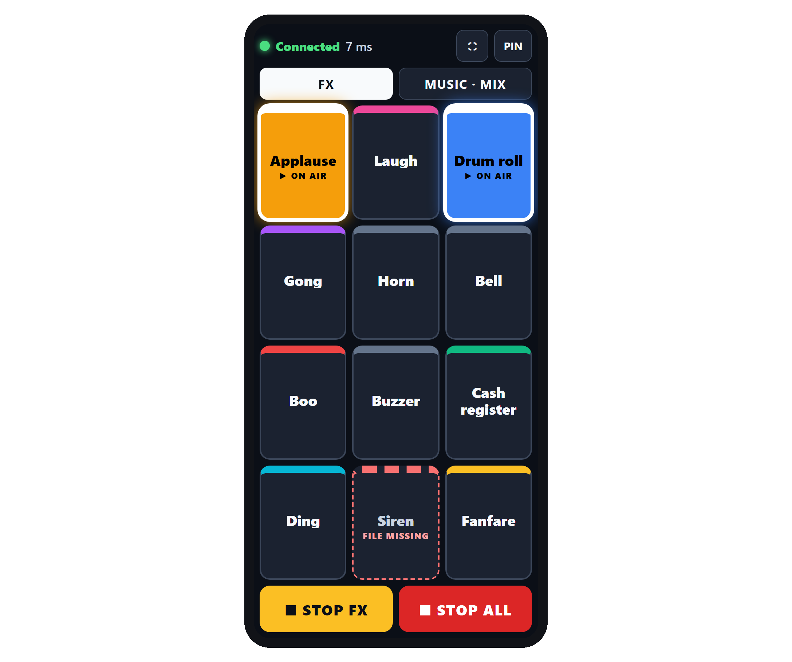
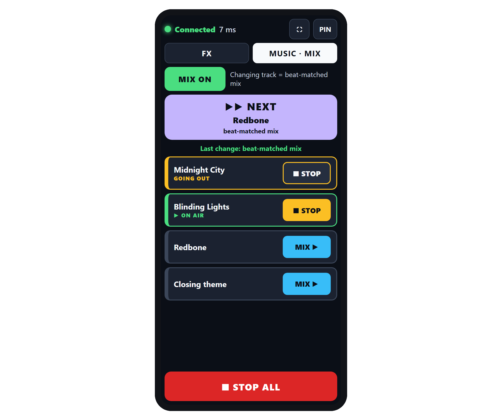

# Chapter 11 — Remote Control

---

The person presenting isn’t always seated at the computer. Sometimes the host is on the other side of the studio, behind glass, or moving around with a guest. The **Remote Control** in Runtime Live Machine Pro turns a phone, a tablet or a second computer into a small console linked to the studio: the **effect pads** (applause, laughter, gong…), the **Music column** with **MIX mode**, and the two stop buttons, **STOP FX** and **STOP ALL**. All it takes is the browser: nothing is installed on the remote device.

---

## 11.1 How it works

When you enable it, RLMP starts a small **local web server** inside itself. The remote device opens an address in its browser and gets a control page that mirrors the studio in real time: whatever starts or stops on the main computer shows up on the phone at once, and vice versa.

Everything happens **inside the local network**: the server is reachable from devices on the studio’s own Wi-Fi or wired network, and it doesn’t go through the internet. The server listens on port **8787**.

---

## 11.2 Activation

1. Open the **Settings** from the Tools menu and stay on the *General* tab.
2. In the **Remote Control** section, set the switch to **Active**.
3. A panel appears with the **QR code**, the six-digit **PIN**, the **address** to open on the remote device and the number of **connected devices**.

*Figure 11.1 — The Remote Control section of the Settings: QR code, PIN, address, connected devices, “Copy link” and “New PIN”.*

The panel contains:

- **QR code.** Scanned with the phone’s camera, it opens the control page already connected: there is no address and no PIN to type. The PIN travels in the part of the link after the `#` sign, which the browser never sends over the network.
- **PIN.** Six digits. **It stays the same from one launch to the next**: a phone that has used it once reconnects on its own, even after RLMP has been closed and reopened.
- **Address.** In the form `http://<computer-address>:8787`. RLMP lists the address of the real network (Wi-Fi or cable) first and those of virtual adapters (WSL, Hyper-V, VirtualBox) last. If the computer has more than one, the **other addresses** appear below, to try if the first one does not respond.
- **Connected devices.** Updated live, and green when at least one device is connected: it confirms the phone is linked to the studio without having to try a pad on air.
- **Copy link.** Copies the address (without the PIN) to the clipboard, for example to send it to your phone via Telegram or WhatsApp.
- **New PIN.** Generates a different PIN, for example after showing it to someone. Connected devices are disconnected and must enter the new PIN or scan the QR code again; if at least one is connected, RLMP asks for confirmation.

Below the switch there is the **Turn on Remote Control when the app opens** box. It is **off by default**: in that case the server stays off until you turn it on by hand, and no network service runs without your say-so. Tick it if you use the phone in every show.

If startup fails, typically because port 8787 is already taken by another copy of RLMP left open or by another program, the switch turns back off and a message shows the reason.

---

## 11.3 Connecting the phone or tablet

The quickest way is to **scan the QR code** with the phone’s camera and tap the link that appears. The page opens already connected.

Otherwise, open the device’s browser, type the address shown in the Settings and enter the **PIN**: the page connects by itself as soon as the sixth digit is in. From then on the PIN is remembered on the device, and next time you only need to reopen the page.

The page follows the **language of the device’s browser**: Italian or English.

At the top there is the status line, with a coloured dot and a label: **Connected** in green, followed by the connection delay in milliseconds (round trip). On the right there are two buttons:

- **⛶ (full screen)** — hides the browser bar and leaves all the space to the controls. It doesn’t appear where the browser doesn’t allow it, for example on iPhone.
- **PIN** — forgets the stored PIN and goes back to the PIN screen. Use it to connect to another studio or with another PIN.

> **Operational tip.** On a local network the browser cannot stop the phone from turning its screen off. The page reconnects by itself when the phone wakes up, but on air it’s worth lengthening the screen timeout, or keeping the phone on charge.

---

## 11.4 The FX tab: the pads from your phone

*Figure 11.2 — The FX tab on the phone: two effects on air, lit in their colours, and STOP FX and STOP ALL at the bottom.*

The **FX** tab is the one that opens first. It shows every effect in the studio’s pad FX (Chapter 7), with the same names and colours, laid out in a grid that fills the screen with no scrolling. If there are many effects, they are spread over pages that you turn with the **◀** and **▶** buttons.

- **A pad fires as soon as your finger touches it**, not when you lift it, like a hardware pad: the time between the tap and the effect on air is the network’s, usually a few thousandths of a second.
- **Tapping again** an effect that is on air stops it, exactly like clicking the pad in the studio.
- **Several effects play at once**: applause does not stop laughter.
- An effect on air **lights up in its colour** with the label **▶ ON AIR**, and goes dark by itself when it ends.
- An effect whose file cannot be found has a red dashed border and the label **FILE MISSING**: tapping it does nothing.

**Every tap is confirmed by the studio.** If the confirmation doesn’t arrive within a second and a half, the pad turns red with the label **NOT RECEIVED** and the phone vibrates (where vibration is available): you know at once that the effect did not start.

At the bottom of the page there are two large buttons:

- **■ STOP FX** — stops only the effects. The music and everything else stay on air.
- **■ STOP ALL** — stops everything, like the ALL button or the `Esc` key in the studio.

Unlike the pads, these two buttons fire when you **lift** your finger: they sit where your thumb rests, and a STOP ALL fired by mistake would leave the show silent.

---

## 11.5 The MUSIC tab and MIX mode

*Figure 11.3 — The MUSIC tab with MIX on: NEXT with the title of the following track, the track GOING OUT during the mix and the one ON AIR.*

The **MUSIC** tab mirrors the studio’s Music column. At the top are the **MIX mode** controls (Chapter 7):

- **MIX ON / MIX OFF** — turns MIX mode on and off. Turning it on from the phone also opens the MIX view on the studio screen. Next to it, a line reminds you what changing track does: “beat-matched mix” with MIX on, “hard cut” with MIX off. While MIX is on, the tab is called **MUSIC · MIX**.
- **▶▶ NEXT** — the large button. It shows the title of the next track and how the change will happen: **beat-matched mix** or **classic crossfade**. Tapping it, the studio moves to that track with a mix, even if MIX is off: it’s the command for fast changes. Tracks whose file cannot be found are skipped. If nothing is on air, the button becomes **▶ START** and starts the first track; once the playlist is over it becomes **END OF PLAYLIST** and does nothing.
- **Last change** — a line tells you how the last change went: beat-matched mix (in green), classic crossfade or not carried out (in amber).

Below is the track list. The track on air carries the label **▶ ON AIR**; during a mix, the one going out carries the label **GOING OUT** and an amber border. Each row has a button:

- **▶ PLAY** — starts the track. With MIX on and a track on air it becomes **MIX ▶**: the studio gets there with a mix instead of a cut.
- **■ STOP** — stops the track that is on air or going out.

STOP ALL stays at the bottom of the page; STOP FX only appears in the FX tab.

> **Operational tip.** For a fast chart countdown, or for a medley while waiting for the televote to close: in the studio choose the **SHORT** mix length in the MIX view (Chapter 7), then on the phone turn MIX on, press **▶ START** and, whenever you want to move on, **▶▶ NEXT**. Your hands stay free for the microphone.

---

## 11.6 Connection and status

The page keeps an eye on the connection by itself. Every three seconds it checks that the studio answers and shows the delay in the status line. If something goes wrong, it says so:

- **Reconnecting…** (amber) — the connection dropped and the page is trying again. The pads turn grey until it’s back.
- **Not connected — retrying…** — the studio doesn’t answer (computer off, no network, RLMP closed). The page keeps trying and reconnects as soon as it can, without asking for the PIN again.
- **Remote control turned off in the studio — waiting…** — someone turned Remote Control off in the studio. The page reconnects when it is turned back on.
- **Not connected: the command was not sent.** — you tapped a pad while there was no connection.

Taps made without a connection **are not queued**: applause that starts ten seconds late is worse than applause that never starts.

When you turn the phone’s screen back on or return to the page, the connection is checked at once. If a **new PIN** has been generated in the studio, the page goes back to the PIN screen with the message “The PIN was changed in the studio: enter the new one”. If the page is already open, just scan the new QR code: it reconnects by itself.

---

## 11.7 Security and limits

- **PIN required.** No device can send commands without the six-digit PIN. The PIN is created with the system’s cryptographic generator.
- **Attempt protection.** After ten wrong attempts in five minutes from the same device, access from that device is temporarily blocked.
- **Only from the remote control page.** The server accepts connections only from the page it serves itself: a web page from another site, opened on a device on the same network, is rejected before it can even ask for the PIN.
- **Closed list of commands.** The server accepts only the intended commands: firing and stopping FX pads, STOP FX, starting and stopping tracks in the Music column, NEXT, turning MIX mode on and off, STOP ALL. Every pad or track commanded must exist in the studio; any other request is refused.
- **What stays in the studio.** The other columns, the clip editor, the settings, recording and project management are used only from the main computer.
- **Local network only.** The server is meant for the studio network. The PIN doesn’t change by itself: if the network is open or shared, consider who can reach it and use **New PIN** when needed.
- **Shutdown.** The server stops when the application closes.

---

## 11.8 If the phone cannot find the studio

1. **Same network.** Phone and computer must be on the same Wi-Fi network, **not the guest network**: many routers’ guest networks isolate devices from each other.
2. **Windows firewall.** The first time the server starts, Windows asks whether to allow Runtime Live Machine Pro on the network. Allow it. If your home or studio network is set as “Public”, allow it on public networks too.
3. **Another address.** If the first address doesn’t respond, try the others listed in the Settings.
4. **Port in use.** If the switch turns itself off with a message, port 8787 is used by another copy of RLMP or by another program: close it and turn Remote Control back on.
