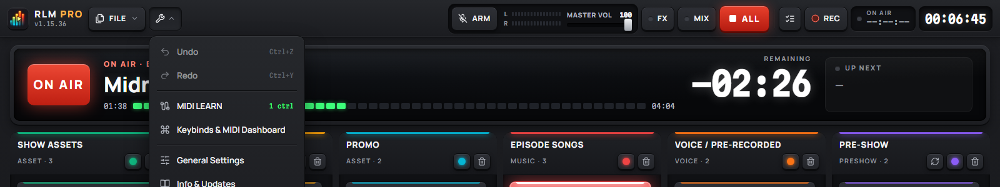
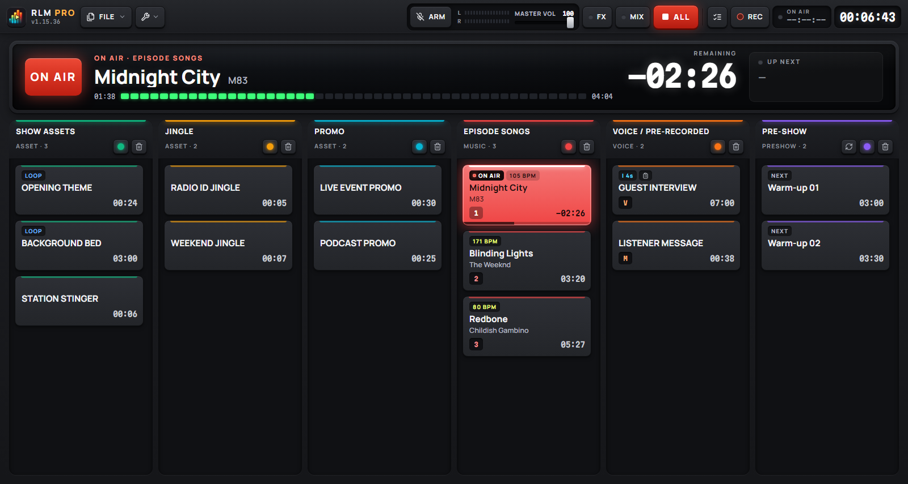

# Chapter 3 — The working interface

---

The Runtime Live Machine Pro interface is designed like a hardware broadcast surface: raised keys, recessed displays, LEDs in the colour of each column. At rest it stays quiet, and whatever goes on air lights up. The dark theme, the high contrast and the large type are there so you can read everything at a glance, even in the busiest moments of a live show.

When you open a project, the screen divides into three bands: the **Control Bar** at the top, which manages the project and the system; the **ON AIR display** just below it, which puts the playing track front and centre; and the **broadcast grid** in the centre, where the actual work happens.

---

## 3.1 The Control Bar (Header)

The header spans the full width of the screen and is split into two groups. On the left are the commands you don’t need while on air: the logo, the **FILE** menu and the **Tools** menu. On the right, in a row, are the live controls: microphone, VU meter, master volume, FX, MIX, STOP ALL, Playout Log, recording, On Air timer and clock.

### Identity

**Logo and version.** At the far left, the logo sits beside the wordmark **RLM PRO**, with “PRO” in amber. Below it, in small type, is the installed version (`v1.15.36`). Hover over the logo to reveal the full software name and version number.

### File menu

The **FILE** button opens a menu with the project operations:

- *New Project* — opens an empty session. If there are unsaved changes, the software asks for confirmation.
- *Save Project* — a quick save to the current `.lmp` file.
- *Save As…* — always opens the dialog box, for creating progressive versions (e.g. `Ep47_draft.lmp`, `Ep47_final.lmp`).
- *Export project with audio* — consolidates all the audio inside the project (an `audio/` subfolder) and repoints the clips to it, so you can safely delete the originals. Described in Chapter 10.
- *Load Project* — opens a `.lmp` project from disk.
- *Import M3U* — imports a playlist in M3U format as a sequence of clips.

When there are unsaved changes, an amber dot lights up on the corner of the FILE button and, in the menu, the *Save Project* entry turns amber. After an automatic save, the green *Auto-saved* label appears briefly below the button.

### Tools

Next to FILE, the button with the **wrench** icon opens the Tools menu:

- *Undo* and *Redo* — the running-order edit history (`Ctrl+Z` / `Ctrl+Y`).
- *MIDI Learn* — enables MIDI learning mode (Chapter 8). To the right of the entry you can see how many MIDI controllers are connected.
- *Keybinds & MIDI Dashboard* — the window for assigning keys to clips.
- *General Settings* — the software’s global preferences (Chapter 13).
- *Info & Updates* — version, credits and manual update check.

While MIDI Learn is active, the Tools button keeps showing a label, even with the menu closed: the word MIDI, or the seconds left in the learning countdown.

*Figure 3.1 — The Control Bar with the Tools menu open: logo, FILE and Tools on the left; the live controls on the right.*

### Microphone, levels and transport

**ARM (microphone).** Arms and disarms the microphone for **Smart Mic** (Chapter 6). Disarmed, the button shows a crossed-out microphone icon. Armed, the icon is replaced by a small eight-LED VU with the microphone level, and the **Mic Vol** slider appears next to it; while you speak, the button turns red and pulses. The **On Mix** label, on the bottom edge of the button, shows that the voice is also going into the mix. Smart Mic must be enabled in the *Microphone* tab of the Settings (Chapter 13): if you turn it off, the microphone is disarmed.

**Stereo VU meter (L/R).** Two rows of 16 LEDs, one per channel, show the real output level after the Master Volume. Each LED is worth 3 dB: the LEDs are green up to −12 dBFS, yellow up to −3 dBFS, and the last one is red, right below the limiter. The peak LED stays lit for about a second and a half, so you can see even the shortest peaks. If the last LED stays lit for long, the signal is pushing against the limit: lower the level.

**Master Volume.** The **MASTER VOL** fader controls the software’s overall output volume, from 0 to 100; the value is shown next to the label. It acts as a master fader: brought to zero, no sound comes out, regardless of the state of the individual clips. If you have mapped a MIDI control to the Master Volume, the assignment (for example `C7`) appears in place of the value.

**FX.** Opens and closes the pad FX, the effects *jingle machine* (Chapter 7). The LED on the button is green while the pad is open; a small counter shows how many effects are playing at that moment.

**MIX.** Opens and closes the Automix view, the deck dedicated to the Music column (Chapter 7). Here too, the green LED means the view is open.

**STOP ALL (red “ALL” button).** Instantly stops every active clip and cancels any fades in progress. It is the system’s emergency command. The `Esc` key does the same when the application is in focus, even while you are typing in a text field.

> **Note.** Unlike previous versions, `Esc` is no longer registered as a system-wide global shortcut: it acts when RLMP is the active window. This choice lets dialog boxes use `Esc` to close without stopping the live show.

### Session indicators

At the far right you find the **Playout Log** button (the chronological launch log, Chapter 13), the **REC** recording button (Chapter 9), the **On Air timer** and the **studio clock**.

The On Air timer is a small display labelled ON AIR: at rest it shows `--:--:--`; when the show starts, a red LED pulses and the time runs in `HH:MM:SS` format. The studio clock is in 24-hour format, synchronized with the system clock.

Unobtrusive notifications (**toasts**) about completed operations or system warnings appear at the bottom right. Unlike blocking dialogs, toasts disappear on their own after a few seconds and don’t interrupt playback.

---

## 3.2 The ON AIR display

Between the Control Bar and the grid sits a full-width display that shows the track on air, readable even from across the room. It is **always there** and has a fixed height, so the columns below it never move. With nothing playing it shows **OFF AIR**, the words “No track on air” and an unlit lamp.

From left to right you find:

- **ON AIR** — the lamp: red and lit while a track is on air, grey and unlit at rest.
- **Title and column** — the “ON AIR” label followed by the column name, the clip title in large type and, next to it, the artist (or “In loop” for looping clips).
- **LED bar** — below the title, a row of LEDs that light up as the track plays, with the elapsed time on the left and the total duration on the right. If the clip has Intro and Outro markers (Chapter 5), the LEDs before the end of the intro are cyan and those from the Outro on are amber; two vertical ticks, one cyan and one amber, mark the two points. The coloured zones are visible even while the LEDs are off, so you know in advance where the Outro falls.
- **REMAINING timer** — the time left until the end of the track, in a colour that changes with the phase: **cyan** during the intro (counting down to the end of the intro), **white** in the body of the track, **amber** from the Outro point on, **flashing red** in the last 10 seconds. For looping clips it shows “LOOP”. In the 15 seconds before the Outro, the amber **OUTRO IN** label appears below the timer with its countdown.
- **UP NEXT** — the clip that will start next, with artist and duration, when the clip on air is set to *Play Next*: the LED next to the label turns green. Otherwise the box stays unlit and shows a dash.

If several clips are playing together, the display shows the one from the highest-priority column, in this order: Episode Songs, Pre-Show, Voice, then the other columns. Pad FX effects never appear on the display. When one track hands over to the next in a sequence, the display holds the track that just ended for a moment instead of flashing OFF AIR.

---

## 3.3 The six-column grid

*Figure 3.2 — The working interface: the ON AIR display with a track on air and the six-column grid. The clip on air is lit in the colour of its column.*

The grid is the software’s operational centre: six vertical columns side by side, each with its own header, its own colour and its own audio-behaviour logic. Sound effects have no column in the grid: they live in the pad FX (Chapter 7).

### Column headers

The header has two rows, with a glowing strip in the column’s colour along its top edge. The top row holds the full column title. The bottom row shows the type (ASSET, MUSIC, VOICE or PRESHOW) with the number of clips and, on the right, the column’s buttons.

The header also doubles as a status indicator. When the playing clip is the last one available in the column, is not looping, and less than **20 seconds** remain until the end, the **DEAD AIR** alarm goes off: the header turns amber, the strip flashes, a warning triangle appears next to the title and the **END** badge appears below it. During the alarm the column’s buttons are hidden. It’s the advance notice that gives you time to prepare the next track before silence.

Each column’s colour is customizable: click the button with the coloured dot, in the second row of the header, to open a palette of **30 shades**. The choice is saved in the project file.

When a column contains at least one clip, a button with a **trash** icon appears in its header: the **Clear column** command removes every clip in that column in one go. For safety it always asks for confirmation, stating how many clips will be removed, and the operation can be reversed with *Undo* (`Ctrl+Z`). On empty columns the button does not appear.

The **Pre-Show** column header also carries a **rotation** button: when active, the pre-broadcast queue automatically inserts jingles and promos at regular intervals (Chapter 13).

### The six columns

**Show Assets (Green)**
The structural elements of the show: idents, backing tracks, beds, institutional stingers. They behave as background elements: they yield space when voices or songs come in, but keep their internal rotation until they are stopped.

**Jingle (Amber)** and **Promo (Cyan)**
Two columns dedicated, respectively, to identifying jingles and to promos or self-promotion. In audio terms they behave exactly like Show Assets (they belong to the same family), but keeping them separate keeps the running order tidy and readable.

**Episode Songs (Red)**
The music playlist. Clips in this column take an active part in the automatic mixing: they are lowered when voices play and, in turn, silence the Asset beds when they start playing (Chapter 6). On music clips the software automatically detects the **BPM**, shown with a dedicated badge.

**Voice / Recordings (Orange)**
Interviews, pre-recorded spoken segments, voice messages. This column has the **highest priority** in the mixing system: when a clip here is playing, all other signals are lowered to a background level.

**Pre-Show (Purple)**
The pre-broadcast warm-up playlist. It works as a self-contained music queue, with optional rotation of jingles and promos. When the show proper begins, this column is typically emptied or disabled.

---

## 3.4 The audio card (Clip)

Every imported audio file becomes a **card** in the grid: a raised rectangular key. The card is the operating unit of the system: you see it, launch it, configure it, move it.

### Anatomy of a card

From top to bottom, a card shows: a thin strip in the column’s colour, the badge row, the title on a line of its own, the artist (only for music clips that have one) and, at the bottom, the assigned keys on the left and the timer on the right. The column type is not repeated on the card: the header already says it.

**Title and artist.** The file name, or the custom name assigned in the properties. The custom title changes only the label inside the software; the original file on disk stays untouched. For music clips, the artist name may appear below the title.

**Timer.** At rest, it shows the clip’s total duration in `MM:SS` format. During playback it switches to a **countdown**, with the negative prefix (e.g. `−01:20`). When less than 15 seconds remain, the digits turn white on a dark label and flash.

**Status badges.** Small labels communicate the configured properties at a glance:

- **ON AIR** — the clip is playing: a dark label with a red LED.
- **LOOP** — the clip will restart from the beginning when playback ends.
- **NEXT** — when this clip ends, the next one in the column will start automatically.
- **▶ UP NEXT** — highlights which clip will be next to start in the automatic sequence: the badge is green and flashes, the card has a green ring and its top strip turns green.
- **### BPM** — the detected tempo, on music clips, written in light yellow.
- **I ##s** — the clip has an Intro point configured (Chapter 5): the badge, in cyan, shows its duration in seconds and is always visible, even when the clip is stopped.
- **TRIM…** — silence analysis in progress (Auto-Trim), with an amber LED.
- **FADE OUT** — appears on the outgoing clip during a crossfade or a fade.
- **Clipboard icon** — the clip has a note attached in the NoteBoard (Chapter 13).

**Assignments.** If the clip has a keyboard key assigned, the key appears at the bottom left, in a dark box with the character in the column’s colour; if it has a MIDI binding, the label `M` followed by the note number (e.g. `M60`) appears in cyan.

**Structure cues.** If markers are configured, during playback the assigned keys give way to the countdowns `INTRO −MM:SS` (cyan label) and `OUTRO IN −MM:SS` (amber label); once the tail has begun, the label becomes `OUTRO`.

**The card on air.** When a clip goes on air, the whole card lights up in the colour of its column. The text is dark on light colours and white on dark ones, chosen by contrast: a midnight-blue column reads as well as a yellow one. The top strip turns white and a progress bar runs along the bottom of the card.

### Interacting with the cards

- **Left click** — starts the clip if it is stopped; stops it (with a fade out) if it is playing.
- **Ctrl + Click** (Windows/Linux) or **Cmd + Click** (macOS) — selects the clip without starting it. A blue ring appears around the card. Useful for multiple selection and bulk deletion.
- **Delete key** (or *Delete* / *Backspace*) — removes the selected clips from the grid. If more than one clip is selected, the software asks for confirmation.
- **Right click** — opens the **Clip Settings**: properties, waveform editor, notes (Chapter 5).
- **Drag & Drop** — drag a card to reorder it within the column or move it to another. A glowing blue line shows the insertion point while dragging.

### Cards in an error state

A dark red card, with the red **MISSING FILE** badge and the title in light red, signals that the referenced audio file is no longer reachable: it has been moved, renamed, or is on an external disk that is not connected. The clip is not playable until the file returns to its original path. Handling path errors is covered in Chapter 14.
