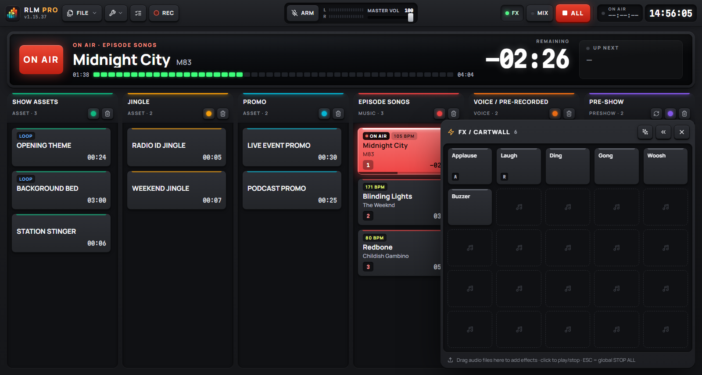
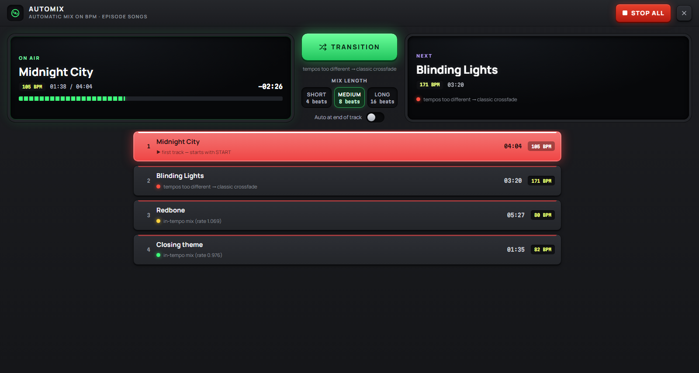

# Chapter 7 — The Pad FX and the Automix view

---

Two working surfaces live above the grid, each summoned with a key and built for opposite moments of production. The **pad FX** fires off effects and stingers reliably without interrupting anything. The **Automix view** handles the music flow the way a DJ would. Neither takes space away from the grid: they open when you need them and close with a click.

---

## 7.1 The pad FX: the jingle machine

*Figure 7.1 — The pad FX: the 5×5 jingle machine of sound effects, with overlapping playback.*

Sound effects have no column in the grid. They live in the **pad FX**, a grid panel of cells (a *jingle machine*) that opens from the **FX** button in the header (the button’s LED turns green) and stays floating in a corner of the screen.

The pad is a **non-blocking overlay**: it doesn’t obscure the board and doesn’t intercept clicks elsewhere. You can launch an effect and, at the same moment, keep operating on the columns or the header controls. For that reason the `Esc` key doesn’t close the pad: it remains the STOP ALL command, always available. The pad closes from its own close button or by toggling FX again.

### Loading and launching effects

The pad starts with a grid of 25 cells (5×5) and grows in rows as you add more effects. To populate it, **drag audio files straight onto the pad’s cells**, exactly as you would with a grid column.

A click on a cell **launches the effect**. The pad effects are polyphonic and overlap: several cells can play together, over anything on air, without stopping it. The audio behaviour is identical to a normal clip; only the launch surface changes. The cell of the effect on air lights up in its colour, and a counter on the FX button in the header shows how many effects are playing at that moment.

### Configuring an effect

Effects are configured on two levels, meant for two different needs:

- **Quick settings** — the common case for a jingle machine: name, colour, volume, loop. It takes a few seconds.
- **Full settings** — the same window as the grid clips (waveform editor, trim, markers, fades, key assignment), reachable from the “Full settings…” entry within the quick settings.

### Pad position

The pad can sit in the bottom-left or bottom-right corner of the screen: the preference is set with the arrow button in the pad’s header and is remembered across sessions. On the right it covers the NoteBoard and the last column; choose the side based on how you’ve laid out your running order.

> **Note.** In MIDI Learn mode, a click on a pad cell **selects** the effect for assignment instead of playing it — so you don’t send a jingle on air while mapping the controls (see Chapter 8).

---

## 7.2 The Automix view

*Figure 7.2 — The Automix view: the Music-column deck, the mix length (short, medium, long), BPM compatibility and automatic end-of-track mode.*

The **Automix view** is the deck of the Music column: a full-screen display, summoned from the **MIX** button in the header, that presents the music running order like a DJ console. It opens above the board but below the pad FX, so the effects stay usable even while Automix is open. As with the pad, `Esc` doesn’t close it: it remains the emergency command, and the STOP ALL button stays reachable in the header.

Opening the view turns on **MIX mode**: while it stays open, **every change from one Music-column track to another is a mix**, even when you make the change yourself. Closing the view brings back the normal behaviour, where a track launched by hand cuts the one on air.

### The deck

At the top there are two displays. On the left, the track **on air**: title, BPM, elapsed time and duration, time remaining and an LED progress bar. On the right, the **next** track in the Music column, with BPM, duration and compatibility. Between them sits the big green **TRANSITION** button, which moves to the next track with a mix. If nothing is on air, you find **START** in its place, which starts the first track.

Below the displays is the Music column’s running order, one row per track with number, title, duration and BPM. The row of the track on air is lit in the column’s colour.

### Moving from one track to another

With the view open you can change track in four ways, and all of them produce a mix:

- **TRANSITION** — moves to the next track in the running order. Tracks whose file cannot be found are skipped.
- **Clicking a row** of the running order — moves to that track, wherever it sits. It works from the keyboard too: with the row selected, `Enter` or `Space`. If nothing is on air, the click starts the track. The rows of the track on air and of the one going out don’t respond, so a careless click cannot stop them.
- **Keys and MIDI notes** assigned to Music-column tracks (Chapter 8).
- **From the phone**, with Remote Control: the **NEXT** button and the buttons of the single tracks (Chapter 11).

The track you are leaving fades out while the new one comes in. If you move on before the fade has finished, the oldest track leaves within a quarter of a second: there are never three tracks on air on top of each other.

### Mix length

Below the transition button you choose how long the change lasts:

- **SHORT (4 beats)** — about two seconds at 120 BPM. It’s the choice for fast changes: a **chart countdown** where only the start of each track plays, or a **medley** while waiting for the televote to close.
- **MEDIUM (8 beats)** — about four seconds at 120 BPM. This is the default.
- **LONG (16 beats)** — for unhurried music blocks.

The length is counted in beats of the track on air, so the change always lasts the same number of beats. Your choice is remembered. When the change is a classic crossfade, its length is the crossfade length set in the Settings, *Audio & Mix* tab (Chapter 13).

Below the buttons, a line reports the **outcome of the last change**: *beat-matched mix* in green, or *classic crossfade* with the reason, or *not carried out*, in amber.

### Compatibility and beat-matched mixing

Below the title of each track, a **compatibility dot** with the previous track shows their rhythmic affinity, followed by a short explanation (for example “beat uncertain → classic crossfade”):

- **Green** — the two tempos lock well: the change will be a beat-matched mix.
- **Yellow** — locking is possible, with a more noticeable speed adjustment.
- **Red** — the change will be a classic crossfade; the explanation says why.

In a **beat-matched mix** the incoming track starts on one of its beats, lined up with the beats of the track on air, and its speed is adjusted (by at most 8%, with the pitch preserved) so that the two tempos match. Once the mix is over, the speed returns to the original one little by little, too slowly to be heard. Even in fast changes the new track locks onto the tempo you actually hear, including that of a track that has just come in and is still sped up or slowed down.

Tempo and beat positions come from an automatic analysis of every track in the Music column, done when you drag it into the column or when you open the project. The analysis also gives a **beat-reliability score**. Songs with a steady kick drum pass it easily; ballads, tracks without drums or with a changing tempo usually don’t.

When rhythmic locking isn’t practical (BPM not detected, unreliable beat, tempos too different), the software declares it and falls back to a **classic crossfade**. The worst outcome is always a normal fade, never beats locked at random.

> **Note.** From version 1.15.37 beat detection is more accurate. The first time you open a project created with an earlier version, the tracks in the Music column are analysed again, once only and in the background. Until a track’s analysis has finished, changes involving it are classic crossfades.

> **Operational tip.** Chart countdown or medley: open the MIX view, choose **SHORT**, press **START** and use **TRANSITION**, or click the track you want directly. From the phone you do the same with **NEXT** (Chapter 11).

### Automatic mode

Below the transition button there’s the **Auto at end of track** switch. When it’s active the label turns green and RLMP starts the passage to the next track on its own when the track on air nears the end.

This mode is a deliberate exception to the software’s philosophy, which by design does not automate the show. That’s why it is **disabled by default** and works **only while the Automix view is open**: closing the view disables the automation. It’s the right tool for a continuous music block, the half-hour of music-only before returning to the mic, not for the entire live show.
