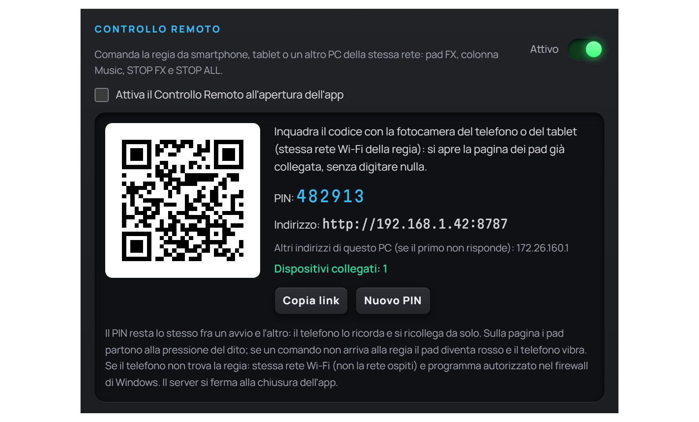
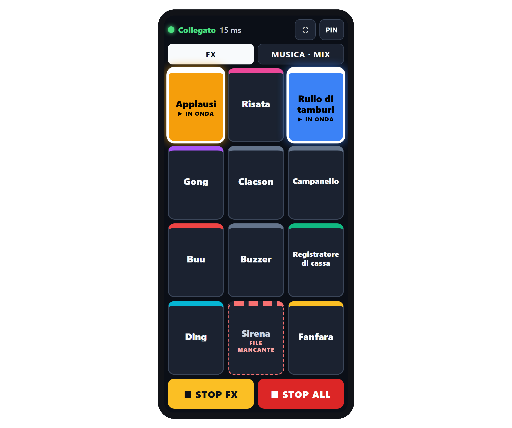
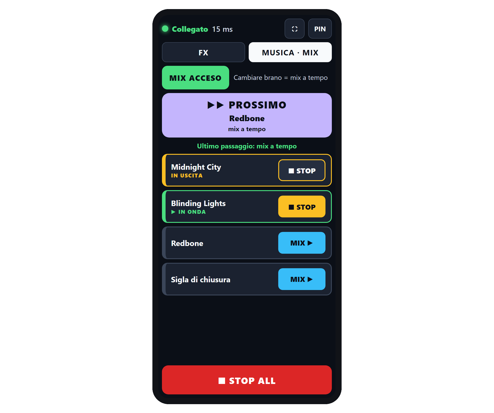

# Capitolo 11 — Controllo Remoto

---

Non sempre chi conduce sta seduto davanti al computer. A volte il conduttore è dall'altra parte dello studio, dietro un vetro, oppure si muove con un ospite. Il **Controllo Remoto** di Runtime Live Machine Pro trasforma un telefono, un tablet o un secondo computer in una piccola console collegata alla regia: i **pad degli effetti** (applausi, risate, gong…), la **colonna Musica** con la **modalità MIX**, e i due tasti di arresto, **STOP FX** e **STOP ALL**. Basta il browser: sul dispositivo remoto non si installa nulla.

---

## 11.1 Come funziona

Quando lo attivi, RLMP avvia al proprio interno un piccolo **server web locale**. Il dispositivo remoto apre un indirizzo nel browser e riceve una pagina di controllo che rispecchia la regia in tempo reale: quello che parte o si ferma sul computer principale si vede subito sul telefono, e viceversa.

Tutto avviene **dentro la rete locale**: il server è raggiungibile dagli apparecchi collegati alla stessa rete Wi-Fi o via cavo dello studio, e non passa da internet. Il server ascolta sulla porta **8787**.

---

## 11.2 Attivazione

1. Apri le **Impostazioni** dal menu Strumenti e resta nella scheda *Generali*.
2. Nella sezione **Controllo Remoto** porta l'interruttore su **Attivo**.
3. Compare un riquadro con il **QR code**, il **PIN** a sei cifre, l'**indirizzo** da aprire sul dispositivo remoto e il numero di **dispositivi collegati**.

*Figura 11.1 — La sezione Controllo Remoto delle Impostazioni: QR code, PIN, indirizzo, dispositivi collegati, «Copia link» e «Nuovo PIN».*

Nel riquadro trovi:

- **QR code.** Inquadrato con la fotocamera del telefono, apre la pagina di controllo già collegata: non serve digitare né l'indirizzo né il PIN. Il PIN viaggia nella parte del link dopo il simbolo `#`, che il browser non invia mai in rete.
- **PIN.** Sei cifre. **Resta lo stesso fra un avvio e l'altro**: il telefono che l'ha usato una volta si ricollega da solo anche dopo aver chiuso e riaperto RLMP.
- **Indirizzo.** Nella forma `http://<indirizzo-del-computer>:8787`. RLMP mette per primo l'indirizzo della rete vera (Wi-Fi o cavo) e in fondo quelli delle schede virtuali (WSL, Hyper-V, VirtualBox). Se il computer ne ha più d'uno, sotto compaiono gli **altri indirizzi**, da provare se il primo non risponde.
- **Dispositivi collegati.** Si aggiorna in tempo reale ed è verde quando c'è almeno un dispositivo: conferma che il telefono è agganciato alla regia, senza bisogno di provare un pad in diretta.
- **Copia link.** Copia negli appunti l'indirizzo (senza PIN), per esempio per mandarlo al telefono via Telegram o WhatsApp.
- **Nuovo PIN.** Genera un PIN diverso, per esempio dopo averlo mostrato a qualcuno. I dispositivi collegati vengono scollegati e dovranno inserire il nuovo PIN o inquadrare di nuovo il QR code: se ce n'è almeno uno, RLMP chiede conferma.

Sotto l'interruttore c'è la casella **Attiva il Controllo Remoto all'apertura dell'app**. È **spenta di default**: in quel caso il server resta spento finché non lo accendi a mano, e nessun servizio di rete è attivo senza una tua scelta. Accendila se usi il telefono a ogni trasmissione.

Se l'avvio non riesce, tipicamente perché la porta 8787 è già occupata da un'altra copia di RLMP rimasta aperta o da un altro programma, l'interruttore torna su spento e compare un messaggio con il motivo.

---

## 11.3 Collegare il telefono o il tablet

Il modo più rapido è **inquadrare il QR code** con la fotocamera del telefono e toccare il link che compare. La pagina si apre già collegata.

In alternativa, apri il browser del dispositivo, digita l'indirizzo mostrato nelle Impostazioni e inserisci il **PIN**: alla sesta cifra la pagina si collega da sola. Da quel momento il PIN resta memorizzato sul dispositivo, e la volta dopo basta riaprire la pagina.

La pagina segue la **lingua del browser** del dispositivo: italiano o inglese.

In alto c'è la riga di stato, con un pallino colorato e una scritta: **Collegato** in verde, seguito dal ritardo del collegamento in millisecondi (andata e ritorno). A destra ci sono due tasti:

- **⛶ (schermo intero)** — toglie la barra del browser e lascia tutto lo spazio ai pulsanti. Non compare dove il browser non lo permette, per esempio su iPhone.
- **PIN** — dimentica il PIN memorizzato e torna alla schermata di inserimento. Serve per collegarsi a un'altra regia o con un altro PIN.

> **Suggerimento operativo.** In una rete locale il browser non può impedire al telefono di spegnere lo schermo. La pagina si ricollega da sola al risveglio, ma in diretta conviene allungare il tempo di spegnimento dello schermo, o tenere il telefono in carica.

---

## 11.4 La scheda FX: i pad dal telefono

*Figura 11.2 — La scheda FX sul telefono: due effetti in onda, accesi del loro colore, e in basso STOP FX e STOP ALL.*

La scheda **FX** è quella che si apre per prima. Mostra tutti gli effetti del pad FX della regia (Capitolo 7), con gli stessi nomi e gli stessi colori, disposti in una griglia che riempie lo schermo senza scorrere. Se gli effetti sono tanti, compaiono più pagine, da sfogliare con i tasti **◀** e **▶**.

- **Il pad parte alla pressione del dito**, non al rilascio, come un pad hardware: il tempo fra il tocco e l'effetto in onda è quello della rete, di solito pochi millesimi di secondo.
- **Toccare di nuovo** un effetto in onda lo ferma, esattamente come il click sul pad in regia.
- **Più effetti suonano insieme**: un applauso non ferma una risata.
- Un effetto in onda si **accende del suo colore** con la scritta **▶ IN ONDA**, e si spegne da solo quando finisce.
- Un effetto il cui file non si trova ha il bordo tratteggiato rosso e la scritta **FILE MANCANTE**: toccarlo non fa nulla.

**Ogni tocco viene confermato dalla regia.** Se la conferma non arriva entro un secondo e mezzo, il pad diventa rosso con la scritta **NON ARRIVATO** e il telefono vibra (dove la vibrazione è disponibile): sai subito che l'effetto non è partito.

In fondo alla pagina ci sono due tasti grandi:

- **■ STOP FX** — ferma solo gli effetti. La musica e il resto restano in onda.
- **■ STOP ALL** — ferma tutto, come il pulsante ALL o il tasto `Esc` in regia.

Questi due tasti, a differenza dei pad, partono al **rilascio** del dito: stanno dove poggia il pollice, e uno STOP ALL partito per sbaglio lascerebbe la diretta muta.

---

## 11.5 La scheda MUSICA e la modalità MIX

*Figura 11.3 — La scheda MUSICA con il MIX acceso: PROSSIMO con il titolo del brano dopo, il brano IN USCITA durante il mix e quello IN ONDA.*

La scheda **MUSICA** riporta la colonna Musica della regia. In cima ci sono i comandi della **modalità MIX** (Capitolo 7):

- **MIX ACCESO / MIX SPENTO** — accende e spegne la modalità MIX. Accenderla dal telefono apre la vista MIX anche sullo schermo della regia. Accanto, una riga ricorda cosa succede cambiando brano: «mix a tempo» con il MIX acceso, «taglio netto» con il MIX spento. Quando il MIX è acceso, la scheda si chiama **MUSICA · MIX**.
- **▶▶ PROSSIMO** — il pulsante grande. Mostra il titolo del brano successivo e come ci si arriverà: **mix a tempo** o **crossfade classico**. Toccandolo, la regia passa a quel brano con il mix, anche se il MIX è spento: è il comando dei passaggi rapidi. I brani il cui file non si trova vengono saltati. Se non c'è niente in onda, il pulsante diventa **▶ START** e fa partire il primo brano; a scaletta finita diventa **FINE SCALETTA** e non fa nulla.
- **Ultimo passaggio** — una riga dice com'è andato l'ultimo cambio: mix a tempo (in verde), crossfade classico o non eseguito (in ambra).

Sotto c'è l'elenco dei brani. Il brano in onda ha la scritta **▶ IN ONDA**; durante un mix, quello che sta uscendo ha la scritta **IN USCITA** e il bordo ambra. Ogni riga ha un pulsante:

- **▶ PLAY** — fa partire il brano. Con il MIX acceso e un brano in onda diventa **MIX ▶**: la regia ci arriva con un mix invece di tagliare.
- **■ STOP** — ferma il brano in onda o in uscita.

STOP ALL resta in fondo alla pagina; STOP FX compare solo nella scheda FX.

> **Suggerimento operativo.** Per una classifica veloce o per un medley in attesa del televoto: in regia scegli la durata del mix **CORTO** nella vista MIX (Capitolo 7), poi dal telefono accendi il MIX, premi **▶ START** e, quando vuoi passare al brano dopo, **▶▶ PROSSIMO**. Le mani restano libere per il microfono.

---

## 11.6 Collegamento e stato

La pagina sorveglia il collegamento da sola. Ogni tre secondi controlla che la regia risponda e mostra il ritardo nella riga di stato. Se qualcosa va storto lo dice:

- **Ricollegamento…** (ambra) — il collegamento è caduto e la pagina sta riprovando. I pad diventano grigi finché non torna.
- **Non collegato — riprovo…** — la regia non risponde (computer spento, rete assente, RLMP chiuso). La pagina continua a riprovare e si ricollega appena può, senza chiedere di nuovo il PIN.
- **Controllo remoto spento in regia — in attesa…** — in regia qualcuno ha spento il Controllo Remoto. La pagina si ricollega quando viene riacceso.
- **Non collegato: il comando non è partito.** — hai toccato un pad mentre il collegamento era assente.

I tocchi fatti senza collegamento **non vengono messi in coda**: un applauso che parte dieci secondi dopo è peggio di un applauso che non parte.

Quando riaccendi lo schermo del telefono o torni sulla pagina, il collegamento viene controllato subito. Se in regia è stato generato un **nuovo PIN**, la pagina torna alla schermata del PIN con la scritta «Il PIN è stato cambiato in regia: inserisci quello nuovo». Se la pagina è già aperta, basta inquadrare il nuovo QR code: si ricollega da sola.

---

## 11.7 Sicurezza e limiti

- **PIN obbligatorio.** Nessun dispositivo può inviare comandi senza il PIN a sei cifre. Il PIN è generato con il generatore crittografico del sistema.
- **Protezione dai tentativi.** Dopo dieci tentativi sbagliati in cinque minuti da uno stesso apparecchio, l'accesso da quell'apparecchio viene bloccato temporaneamente.
- **Solo dalla pagina del controllo remoto.** Il server accetta collegamenti soltanto dalla pagina che serve lui stesso: una pagina web di un altro sito, aperta su un dispositivo della stessa rete, viene respinta prima ancora di poter chiedere il PIN.
- **Comandi su lista chiusa.** Il server accetta solo i comandi previsti: lancio e arresto dei pad FX, STOP FX, avvio e arresto dei brani della colonna Musica, PROSSIMO, accensione e spegnimento della modalità MIX, STOP ALL. Ogni pad o brano comandato deve esistere in regia; qualsiasi altra richiesta viene rifiutata.
- **Cosa resta in regia.** Le altre colonne, l'editor delle clip, le impostazioni, la registrazione e la gestione dei progetti si usano solo dal computer principale.
- **Solo rete locale.** Il server è pensato per la rete dello studio. Il PIN non cambia da solo: se la rete è aperta o condivisa, valuta chi può raggiungerla e usa **Nuovo PIN** quando serve.
- **Spegnimento.** Il server si ferma alla chiusura dell'applicazione.

---

## 11.8 Se il telefono non trova la regia

1. **Stessa rete.** Telefono e computer devono essere sulla stessa rete Wi-Fi, **non sulla rete ospiti**: le reti ospiti di molti router isolano i dispositivi fra loro.
2. **Firewall di Windows.** Al primo avvio del server, Windows chiede se consentire a Runtime Live Machine Pro l'accesso alla rete. Va consentito. Se la rete di casa o dello studio è impostata come «Pubblica», l'accesso va consentito anche sulle reti pubbliche.
3. **Altro indirizzo.** Se il primo indirizzo non risponde, prova gli altri elencati nelle Impostazioni.
4. **Porta occupata.** Se l'interruttore si spegne da solo con un messaggio, la porta 8787 è usata da un'altra copia di RLMP o da un altro programma: chiudila e riattiva il Controllo Remoto.
