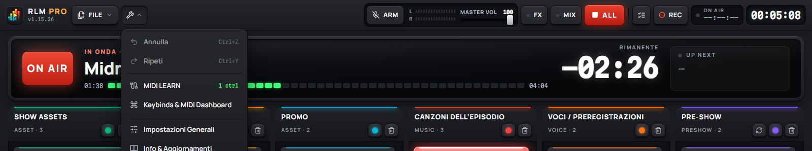
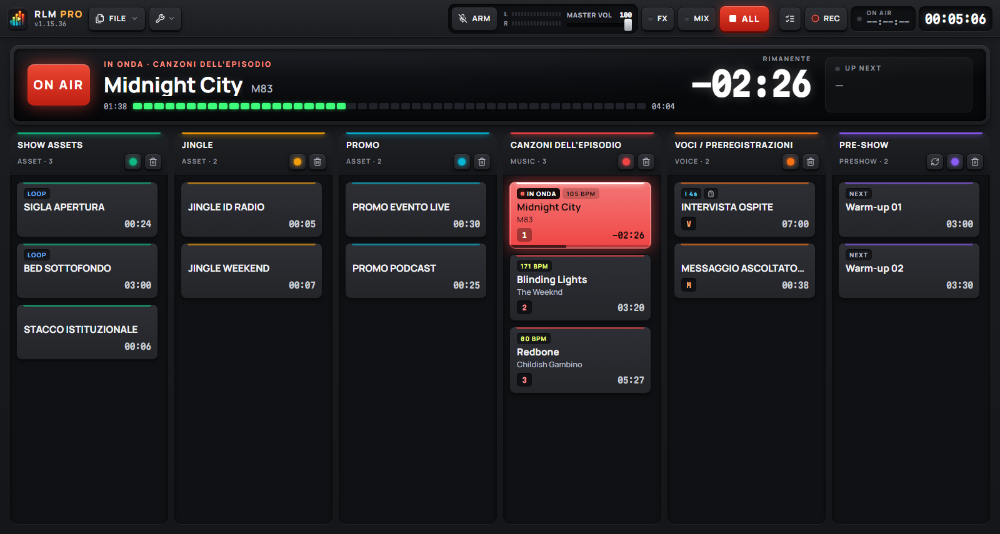

# Capitolo 3 — L'interfaccia di lavoro

---

L'interfaccia di Runtime Live Machine Pro è disegnata come una superficie hardware da regia: tasti in rilievo, display incassati, LED nel colore di ogni colonna. Da ferma resta sobria, e quello che va in onda si accende. Il tema scuro, il contrasto alto e i caratteri grandi servono a leggere tutto a colpo d'occhio anche nei momenti più concitati della diretta.

Quando apri un progetto, lo schermo si divide in tre fasce: la **Barra di Controllo** in alto, che gestisce il progetto e il sistema; il **display IN ONDA** subito sotto, che mette in evidenza il brano che sta suonando; la **Griglia di Regia** al centro, dove si svolge il lavoro effettivo.

---

## 3.1 La Barra di Controllo (Header)

L'header occupa l'intera larghezza dello schermo ed è diviso in due gruppi. A sinistra ci sono i comandi che durante la diretta non servono: il logo, il menu **FILE** e il menu **Strumenti**. A destra, in fila, quelli della diretta: microfono, VU meter, volume master, FX, MIX, STOP ALL, Playout Log, registrazione, timer On Air e orologio.

### Identità

**Logo e versione.** All'estrema sinistra, il logo affianca la scritta **RLM PRO**, con «PRO» in ambra. Sotto, in piccolo, è riportata la versione installata (`v1.15.36`). Passando il mouse sul logo compare il nome completo del software con il numero di versione.

### Menu File

Il pulsante **FILE** apre un menu con le operazioni sui progetti:

- *Nuovo Progetto* — apre una sessione vuota. Se ci sono modifiche non salvate, il software chiede conferma.
- *Salva Progetto* — salvataggio rapido sul file `.lmp` corrente.
- *Salva Come…* — apre sempre la finestra di dialogo, per creare versioni progressive (es. `Ep47_bozza.lmp`, `Ep47_finale.lmp`).
- *Esporta progetto con audio* — consolida tutto l'audio dentro il progetto (sottocartella `audio/`) e vi ripunta le clip, così puoi cancellare gli originali in sicurezza. Descritto nel Capitolo 10.
- *Carica Progetto* — apre un progetto `.lmp` dal disco.
- *Importa M3U* — importa una playlist in formato M3U come sequenza di clip.

Quando ci sono modifiche non salvate, sull'angolo del pulsante FILE si accende un pallino ambra e, nel menu, la voce *Salva Progetto* diventa ambra. Dopo un salvataggio automatico compare per qualche istante, sotto il pulsante, la scritta verde *Salvataggio automatico*.

### Strumenti

Accanto a FILE, il pulsante con l'icona a **chiave inglese** apre il menu Strumenti:

- *Annulla* e *Ripeti* — la cronologia delle modifiche alla scaletta (`Ctrl+Z` / `Ctrl+Y`).
- *MIDI Learn* — attiva la modalità di apprendimento MIDI (Capitolo 8). A destra della voce è indicato quanti controller MIDI sono collegati.
- *Keybinds & MIDI Dashboard* — la finestra di assegnazione dei tasti alle clip.
- *Impostazioni Generali* — le preferenze globali del software (Capitolo 13).
- *Info & Aggiornamenti* — versione, crediti e controllo manuale degli aggiornamenti.

Mentre MIDI Learn è attivo, sul pulsante Strumenti resta visibile, anche a menu chiuso, un'etichetta con la scritta MIDI o con i secondi che restano all'apprendimento.

*Figura 3.1 — La Barra di Controllo con il menu Strumenti aperto: a sinistra logo, FILE e Strumenti; a destra i comandi della diretta.*

### Microfono, livelli e trasporto

**ARM (microfono).** Arma e disarma il microfono per lo **Smart Mic** (Capitolo 6). Da disarmato il pulsante mostra l'icona di un microfono barrato. Da armato, al posto dell'icona compare un piccolo VU a otto LED con il livello del microfono e accanto appare il cursore **Mic Vol**; mentre parli, il pulsante diventa rosso e pulsa. La scritta **On Mix**, sul bordo inferiore del pulsante, segnala che la voce entra anche nel mix. Lo Smart Mic va abilitato nella scheda *Microfono* delle Impostazioni (Capitolo 13): se lo disattivi, il microfono si disarma.

**VU Meter stereo (L/R).** Due file di 16 LED, una per canale, mostrano il livello reale in uscita dopo il Master Volume. Ogni LED vale 3 dB: i LED sono verdi fino a −12 dBFS, gialli fino a −3 dBFS, e l'ultimo è rosso, a ridosso del limiter. Il LED del picco resta acceso per circa un secondo e mezzo, così vedi anche i picchi più brevi. Se l'ultimo LED resta acceso a lungo, il segnale sta spingendo sul limite: riduci il livello.

**Master Volume.** Il fader **MASTER VOL** controlla il volume generale di uscita del software, da 0 a 100; il valore è scritto accanto all'etichetta. Agisce come un fader master: portato a zero, nessun suono esce, indipendentemente dallo stato delle singole clip. Se hai mappato un controllo MIDI sul Master Volume, al posto del valore compare l'assegnazione (per esempio `C7`).

**FX.** Apre e chiude il pad FX, la *jingle machine* degli effetti (Capitolo 7). Il LED sul pulsante è verde quando il pad è aperto; un piccolo contatore segnala quanti effetti sono in riproduzione in quel momento.

**MIX.** Apre e chiude la vista Automix, il deck dedicato alla colonna Musica (Capitolo 7). Anche qui il LED verde indica che la vista è aperta.

**STOP ALL (pulsante rosso «ALL»).** Ferma istantaneamente tutte le clip attive e azzera i fade in corso. È il comando di emergenza del sistema. Il tasto `Esc` sulla tastiera esegue la stessa funzione quando l'applicazione è a fuoco — anche mentre stai scrivendo in un campo di testo.

> **Nota.** A differenza delle versioni precedenti, `Esc` non è più registrato come scorciatoia globale di sistema: agisce quando RLMP è la finestra attiva. Questa scelta consente alle finestre di dialogo di usare `Esc` per chiudersi senza fermare la diretta.

### Indicatori di sessione

In fondo a destra trovi il pulsante del **Playout Log** (il registro cronologico dei lanci, Capitolo 13), il pulsante **REC** della registrazione (Capitolo 9), il **Timer On Air** e l'**orologio di studio**.

Il Timer On Air è un piccolo display con la scritta ON AIR: a riposo mostra `--:--:--`; quando parte la diretta si accende un LED rosso che pulsa e il tempo scorre nel formato `HH:MM:SS`. L'orologio di studio è in formato 24 ore, sincronizzato con l'orologio di sistema.

Le notifiche non intrusive (**toast**) relative a operazioni completate o avvisi di sistema compaiono in basso a destra. A differenza dei dialog bloccanti, i toast scompaiono da soli dopo pochi secondi e non interrompono la riproduzione.

---

## 3.2 Il display IN ONDA

Tra la Barra di Controllo e la griglia c'è un display a tutta larghezza che mostra il brano in onda, leggibile anche da lontano. È **sempre presente** e ha un'altezza fissa, così le colonne sotto non si spostano mai. Senza brani in riproduzione mostra **OFF AIR**, la scritta «Nessun brano in onda» e la spia spenta.

Da sinistra a destra trovi:

- **ON AIR** — la spia: rossa e accesa quando c'è un brano in onda, grigia e spenta a riposo.
- **Titolo e colonna** — l'etichetta «IN ONDA» seguita dal nome della colonna, il titolo della clip in grande e, accanto, l'artista (o «In loop» per le clip in ripetizione).
- **Barra a LED** — sotto il titolo, una fila di LED che si accendono man mano che il brano avanza, con il tempo trascorso a sinistra e la durata totale a destra. Se la clip ha i marker di Intro e Outro (Capitolo 5), i LED che precedono la fine dell'intro sono ciano e quelli dall'Outro in poi ambra; due tacche verticali, una ciano e una ambra, segnano i due punti. Le zone colorate si vedono anche a LED spenti, così sai in anticipo dove cade l'Outro.
- **Timer RIMANENTE** — il tempo che manca alla fine del brano, in un colore che cambia con la fase: **ciano** durante l'intro (conta alla rovescia fino alla fine dell'intro), **bianco** nel corpo del brano, **ambra** dal punto di Outro in poi, **rosso lampeggiante** negli ultimi 10 secondi. Per le clip in loop mostra «LOOP». Nei 15 secondi che precedono l'Outro, sotto il timer compare l'etichetta ambra **OUTRO IN** con il conto alla rovescia.
- **UP NEXT** — la clip che partirà dopo, con artista e durata, quando la clip in onda è impostata su *Play Next*: il LED accanto alla scritta diventa verde. Negli altri casi il riquadro resta spento e mostra un trattino.

Se suonano più clip insieme, il display mostra quella della colonna con priorità più alta, in quest'ordine: Canzoni, Pre-Show, Voci, poi le altre colonne. Gli effetti del pad FX non compaiono mai nel display. Nel passaggio da un brano al successivo in sequenza, il display tiene per un istante il brano appena finito invece di lampeggiare su OFF AIR.

---

## 3.3 La griglia a sei colonne

*Figura 3.2 — L'interfaccia di lavoro: il display IN ONDA con un brano in onda e la griglia a sei colonne. La clip in onda è accesa del colore della sua colonna.*

La griglia è il centro operativo del software: sei colonne verticali affiancate, ciascuna con la sua testata, il suo colore e una propria logica di comportamento audio. Gli effetti sonori non hanno una colonna in griglia: vivono nel pad FX (Capitolo 7).

### Testate di colonna

La testata è su due righe, con una striscia luminosa nel colore della colonna sul bordo superiore. Sopra c'è il titolo intero della colonna. Sotto trovi il tipo (ASSET, MUSIC, VOICE o PRESHOW) con il numero di clip e, a destra, i tasti della colonna.

La testata funge anche da indicatore di stato. Quando la clip in riproduzione è l'ultima disponibile della colonna, non è in loop e mancano meno di **20 secondi** alla fine, scatta l'allarme **DEAD AIR**: la testata diventa ambra, la striscia lampeggia, accanto al titolo compare un triangolo di avviso e sotto il badge **END**. Durante l'allarme i tasti della colonna si nascondono. È l'anticipo che ti dà il tempo di preparare la traccia successiva prima del silenzio.

Il colore di ogni colonna è personalizzabile: clicca sul tasto con il pallino colorato, nella seconda riga della testata, per aprire una palette di **30 tinte**. La scelta viene salvata nel file di progetto.

Quando una colonna contiene almeno una clip, nella testata compare un tasto con l'icona a **cestino**: il comando **Svuota colonna** rimuove in un colpo solo tutte le clip di quella colonna. Per sicurezza chiede sempre conferma, indicando quante clip verranno rimosse, e l'operazione è reversibile con *Annulla* (`Ctrl+Z`). Sulle colonne vuote il tasto non appare.

Nella testata della colonna **Pre-Show** compare inoltre un tasto di **rotazione**: quando è attivo, la coda pre-diretta inserisce automaticamente jingle e promo a intervalli regolari (Capitolo 13).

### Le sei colonne

**Show Assets (Verde)**
Gli elementi strutturali dello show: sigle, basi musicali, sottofondi (*bed*), stacchi istituzionali. Si comportano come elementi di secondo piano: cedono spazio quando sopraggiungono voci o canzoni, ma mantengono la rotazione interna finché non vengono fermate.

**Jingle (Ambra)** e **Promo (Ciano)**
Due colonne dedicate, rispettivamente, ai jingle identificativi e alle promo o autopromozioni. Sul piano audio si comportano esattamente come gli Show Assets (appartengono alla stessa famiglia), ma tenerle separate mantiene la scaletta ordinata e leggibile.

**Canzoni dell'episodio (Rosso)**
La playlist musicale. Le clip di questa colonna partecipano attivamente al mixaggio automatico: vengono abbassate quando suonano le voci e, a loro volta, silenziano le basi degli Assets quando entrano in riproduzione (Capitolo 6). Sulle clip musicali il software rileva automaticamente il **BPM**, mostrato con un apposito badge.

**Voci / Preregistrazioni (Arancione)**
Interviste, blocchi parlati preregistrati, messaggi vocali. Questa colonna ha la **priorità massima** nel sistema di mixaggio: quando una clip qui è in riproduzione, tutti gli altri segnali vengono abbassati a un livello di sottofondo.

**Pre-Show (Viola)**
La playlist di riscaldamento pre-diretta. Funziona come una coda musicale autonoma, con rotazione opzionale di jingle e promo. Quando inizia la diretta vera e propria, questa colonna viene tipicamente svuotata o disattivata.

---

## 3.4 La Card Audio (Clip)

Ogni file audio importato diventa nella griglia una **card**, un tasto rettangolare in rilievo. La card è l'unità operativa del sistema: la vedi, la lanci, la configuri, la sposti.

### Anatomia di una card

Dall'alto in basso, una card mostra: una sottile striscia nel colore della colonna, la riga dei badge, il titolo su una riga tutta sua, l'artista (solo per le clip musicali che ne hanno uno) e, in fondo, i tasti assegnati a sinistra e il timer a destra. Il tipo della colonna non è ripetuto sulla card: lo dice già la testata.

**Titolo e artista.** Il nome del file o il nome personalizzato assegnato nelle proprietà. Il titolo personalizzato cambia solo l'etichetta nel software; il file originale sul disco rimane intatto. Per le clip musicali, sotto il titolo può comparire il nome dell'artista.

**Timer.** A riposo, mostra la durata totale della clip nel formato `MM:SS`. Durante la riproduzione passa al **conto alla rovescia**, con il prefisso negativo (es. `−01:20`). Quando mancano meno di 15 secondi alla fine, le cifre diventano bianche su un'etichetta scura e lampeggiano.

**Badge di stato.** Piccole etichette comunicano in modo immediato le proprietà configurate:

- **IN ONDA** — la clip sta suonando: etichetta scura con un LED rosso.
- **LOOP** — la clip ripartirà dall'inizio al termine della riproduzione.
- **NEXT** — al termine di questa clip partirà automaticamente la successiva nella colonna.
- **▶ UP NEXT** — evidenzia quale clip sarà la prossima a partire nella sequenza automatica: il badge è verde e lampeggia, la card ha un anello verde e la striscia in alto diventa verde.
- **### BPM** — il tempo rilevato, sulle clip musicali, scritto in giallo chiaro.
- **I ##s** — la clip ha un punto di Intro configurato (Capitolo 5): il badge, in ciano, ne indica la durata in secondi ed è sempre visibile, anche a clip ferma.
- **TRIM…** — analisi del silenzio in corso (Auto-Trim), con un LED ambra.
- **FADE OUT** — appare sulla clip uscente durante un crossfade o una dissolvenza.
- **Icona degli appunti** — la clip ha una nota associata nella NoteBoard (Capitolo 13).

**Assegnazioni.** Se la clip ha un tasto della tastiera assegnato, il tasto compare in basso a sinistra, in un riquadro scuro con il carattere nel colore della colonna; se ha un binding MIDI, compare in ciano l'etichetta `M` seguita dal numero di nota (es. `M60`).

**Cue di struttura.** Se sono configurati i marker, durante la riproduzione i tasti assegnati lasciano il posto ai conti alla rovescia `INTRO −MM:SS` (etichetta ciano) e `OUTRO IN −MM:SS` (etichetta ambra); quando la coda è iniziata l'etichetta diventa `OUTRO`.

**La card in onda.** Quando una clip va in onda, tutta la card si accende del colore della sua colonna. Il testo è scuro sui colori chiari e bianco su quelli scuri, scelto in base al contrasto: una colonna blu notte si legge bene quanto una gialla. La striscia in alto diventa bianca e sul fondo della card scorre una barra di avanzamento.

### Interazione con le card

- **Click sinistro** — avvia la clip se è ferma; la ferma (con fade out) se è in riproduzione.
- **Ctrl + Click** (Windows/Linux) o **Cmd + Click** (macOS) — seleziona la clip senza avviarla. Attorno alla card compare un anello blu. Utile per la selezione multipla e la cancellazione in blocco.
- **Tasto Canc** (o *Delete* / *Backspace*) — cancella le clip selezionate dalla griglia. Se sono selezionate più clip, il software chiede conferma.
- **Tasto destro** — apre le **Impostazioni della clip**: proprietà, editor della forma d'onda, note (Capitolo 5).
- **Drag & Drop** — trascina una card per riordinarla all'interno della colonna o spostarla in un'altra. Una linea blu luminosa mostra la posizione di inserimento durante il trascinamento.

### Card in stato di errore

Una card rosso scuro, con il badge rosso **FILE MANCANTE** e il titolo in rosso chiaro, segnala che il file audio referenziato non è più raggiungibile: è stato spostato, rinominato o si trova su un disco esterno non collegato. La clip non è riproducibile finché il file non torna disponibile nel percorso originale. La gestione degli errori di percorso è trattata nel Capitolo 14.
