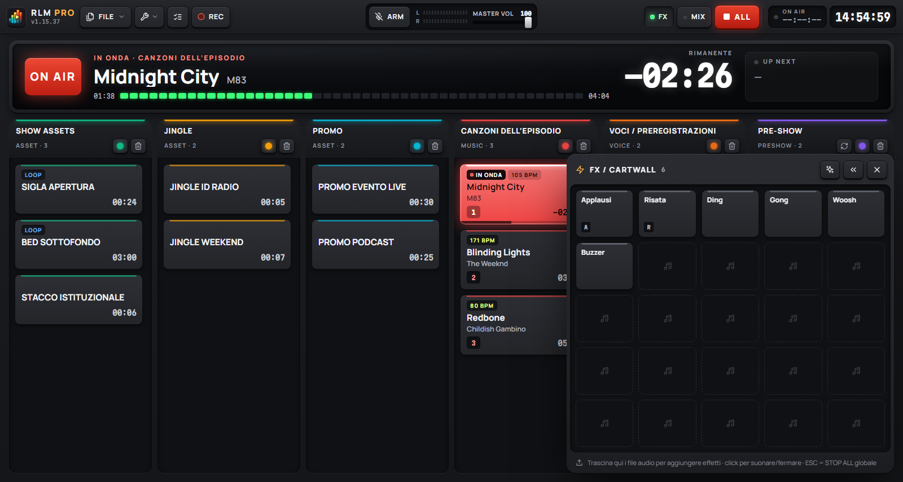
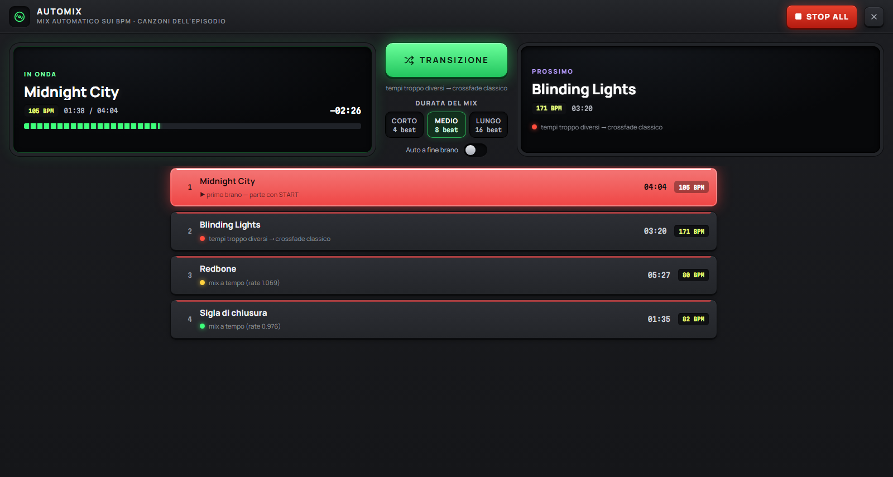

# Capitolo 7 — Il Pad FX e la vista Automix

---

Due superfici di lavoro vivono sopra la griglia, richiamabili con un tasto e pensate per due momenti opposti della regia: il **pad FX**, per lanciare effetti e stacchi a colpo sicuro senza interrompere nulla, e la **vista Automix**, per gestire il flusso musicale come farebbe un DJ. Nessuna delle due sottrae spazio alla griglia: si aprono quando servono e si chiudono con un click.

---

## 7.1 Il pad FX: la jingle machine

*Figura 7.1 — Il pad FX: la jingle machine 5×5 degli effetti sonori, con lancio a sovrapposizione.*

Gli effetti sonori non hanno una colonna nella griglia. Vivono nel **pad FX**, un pannello a griglia di celle (una *jingle machine*) che si apre dal pulsante **FX** nell'header (il LED del pulsante diventa verde) e resta flottante in un angolo dello schermo.

Il pad è un **overlay non bloccante**: non oscura la board e non intercetta i click diretti altrove. Puoi lanciare un effetto e, nello stesso istante, continuare a operare sulle colonne o sui comandi dell'header. Per questa ragione il tasto `Esc` non chiude il pad: resta il comando di STOP ALL, sempre disponibile. Il pad si chiude dal suo pulsante di chiusura o di nuovo dal toggle FX.

### Caricare e lanciare gli effetti

Il pad nasce con una griglia di 25 celle (5×5) e cresce in righe quando aggiungi altri effetti. Per popolarlo, **trascina i file audio direttamente sulle celle** del pad, esattamente come faresti con una colonna della griglia.

Un click su una cella **lancia l'effetto**. Gli effetti del pad sono polifonici e si sovrappongono: più celle possono suonare insieme, sopra qualsiasi cosa sia in onda, senza fermarla. Il comportamento audio è identico a quello di una clip normale: cambia soltanto la superficie di lancio. La cella dell'effetto in onda si accende del suo colore, e un contatore sul pulsante FX nell'header indica quanti effetti stanno suonando in quel momento.

### Configurare un effetto

Gli effetti si configurano su due livelli, pensati per due esigenze diverse:

- **Impostazioni rapide** — il caso comune per una jingle machine: nome, colore, volume, loop. Bastano pochi secondi.
- **Impostazioni complete** — la stessa finestra delle clip di griglia (editor della forma d'onda, trim, marker, fade, assegnazione tasti), raggiungibile dalla voce «Impostazioni complete…» all'interno delle rapide.

### Posizione del pad

Il pad può stare nell'angolo in basso a sinistra o in basso a destra dello schermo: la preferenza si imposta con il tasto a freccia nella testata del pad e viene ricordata tra le sessioni. A destra copre la NoteBoard e l'ultima colonna; scegli il lato in base a come hai disposto la tua scaletta.

> **Nota.** In modalità MIDI Learn, un click su una cella del pad **seleziona** l'effetto per l'assegnazione invece di suonarlo — così non mandi in onda un jingle mentre stai mappando i controlli (vedi Capitolo 8).

---

## 7.2 La vista Automix

*Figura 7.2 — La vista Automix: il deck della colonna Musica, la durata del mix (corto, medio, lungo), la compatibilità BPM e la modalità automatica a fine brano.*

La **vista Automix** è il deck della colonna Musica: una schermata a tutto campo, richiamata dal pulsante **MIX** nell'header, che presenta la scaletta musicale come una console da DJ. Si apre sopra la board ma sotto il pad FX, così gli effetti restano utilizzabili anche mentre l'Automix è aperto. Come per il pad, `Esc` non la chiude: resta il comando di emergenza, e il pulsante STOP ALL rimane raggiungibile nell'header.

Aprire la vista accende la **modalità MIX**: finché resta aperta, **ogni passaggio da un brano della colonna Musica a un altro è un mix**, anche quando sei tu a cambiare brano. Chiudendo la vista si torna al comportamento normale, in cui il brano lanciato a mano taglia quello in onda.

### Il deck

In alto ci sono due display. A sinistra il brano **in onda**: titolo, BPM, tempo trascorso e durata, tempo rimanente e una barra di avanzamento a LED. A destra il **prossimo** brano della colonna Musica, con BPM, durata e compatibilità. In mezzo c'è il pulsantone verde **TRANSIZIONE**, che passa al brano successivo con il mix. Se non c'è niente in onda, al suo posto trovi **START**, che fa partire il primo brano.

Sotto i display c'è la scaletta della colonna Musica, una riga per brano con numero, titolo, durata e BPM. La riga del brano in onda è accesa del colore della colonna.

### Passare da un brano all'altro

Con la vista aperta puoi cambiare brano in quattro modi, e tutti producono un mix:

- **TRANSIZIONE** — passa al brano successivo della scaletta. I brani il cui file non si trova vengono saltati.
- **Clic su una riga** della scaletta — passa a quel brano, qualunque sia la sua posizione. Funziona anche da tastiera: con la riga selezionata, `Invio` o `Spazio`. Se non c'è niente in onda, il clic fa partire il brano. Le righe del brano in onda e di quello che sta uscendo non reagiscono, così un clic distratto non le ferma.
- **Tasti e note MIDI** assegnati ai brani della colonna Musica (Capitolo 8).
- **Dal telefono**, con il Controllo Remoto: il pulsante **PROSSIMO** e i pulsanti dei singoli brani (Capitolo 11).

Il brano che stai lasciando sfuma mentre il nuovo sale. Se passi al brano dopo prima che la dissolvenza sia finita, il brano più vecchio esce in un quarto di secondo: in onda non ci sono mai tre brani sovrapposti.

### Durata del mix

Sotto il pulsante di transizione scegli quanto dura il passaggio:

- **CORTO (4 beat)** — circa due secondi a 120 BPM. È la scelta per i passaggi rapidi: una **classifica veloce** in cui suona solo l'inizio di ogni brano, o un **medley** mentre si aspetta la chiusura del televoto.
- **MEDIO (8 beat)** — circa quattro secondi a 120 BPM. È il valore predefinito.
- **LUNGO (16 beat)** — per i blocchi musicali senza fretta.

La durata si conta in beat del brano in onda, così il passaggio dura sempre lo stesso numero di battute. La scelta resta salvata. Quando il passaggio è un crossfade classico, la durata è quella del crossfade impostata nelle Impostazioni, scheda *Audio & Mix* (Capitolo 13).

Sotto i pulsanti una riga riporta l'**esito dell'ultimo passaggio**: *mix a tempo* in verde, oppure *crossfade classico* con il motivo, o *non eseguito*, in ambra.

### Compatibilità e mix a tempo

Sotto il titolo di ogni brano, un **pallino di compatibilità** con il brano precedente ne indica l'affinità ritmica, seguito da una breve spiegazione (per esempio «beat incerto → crossfade classico»):

- **Verde** — i due tempi si agganciano bene: il passaggio sarà un mix a tempo.
- **Giallo** — aggancio possibile, ma con un adattamento di velocità più marcato.
- **Rosso** — il passaggio sarà un crossfade classico; la spiegazione dice perché.

Nel **mix a tempo** il brano che entra parte su un suo battito, allineato ai battiti di quello in onda, e la sua velocità viene adattata (al massimo dell'8%, con l'intonazione conservata) perché i due tempi coincidano. Finito il mix, la velocità torna a quella originale poco a poco, in modo impercettibile. Anche nei passaggi rapidi il nuovo brano si aggancia al tempo che si sente davvero, compreso quello di un brano appena entrato e ancora accelerato o rallentato.

Il tempo e la posizione dei battiti si ricavano da un'analisi automatica di ogni brano della colonna Musica, fatta quando lo trascini nella colonna o quando apri il progetto. L'analisi dà anche un **punteggio di affidabilità del ritmo**. Le canzoni con una cassa regolare lo superano facilmente; le ballate, i brani senza batteria o con un tempo che cambia di solito no.

Quando l'aggancio ritmico non è praticabile (BPM non rilevato, ritmo poco affidabile, tempi troppo diversi), il software lo dichiara e ripiega su un **crossfade classico**. Il risultato peggiore è sempre una normale dissolvenza, mai battute agganciate a caso.

> **Nota.** Dalla versione 1.15.37 il rilevamento del ritmo è più preciso. Alla prima apertura di un progetto creato con una versione precedente, i brani della colonna Musica vengono analizzati di nuovo, una volta sola e in sottofondo. Finché l'analisi di un brano non è finita, i passaggi che lo riguardano sono crossfade classici.

> **Suggerimento operativo.** Classifica veloce o medley: apri la vista MIX, scegli **CORTO**, premi **START** e usa **TRANSIZIONE**, oppure clicca direttamente il brano che vuoi. Dal telefono la stessa cosa si fa con **PROSSIMO** (Capitolo 11).

### La modalità automatica

Sotto il pulsante di transizione c'è l'interruttore **Auto a fine brano**. Quando è attivo la scritta diventa verde e RLMP fa partire da solo il passaggio al brano successivo quando la traccia in onda si avvicina alla fine.

Questa modalità è un'eccezione deliberata alla filosofia del software, che per scelta non automatizza lo show. Per questo è **disattivata di default** e funziona **solo mentre la vista Automix è aperta**: chiudere la vista disattiva l'automazione. È lo strumento giusto per un blocco musicale continuo, la mezz'ora di sola musica prima di rientrare in voce, non per l'intera diretta.
